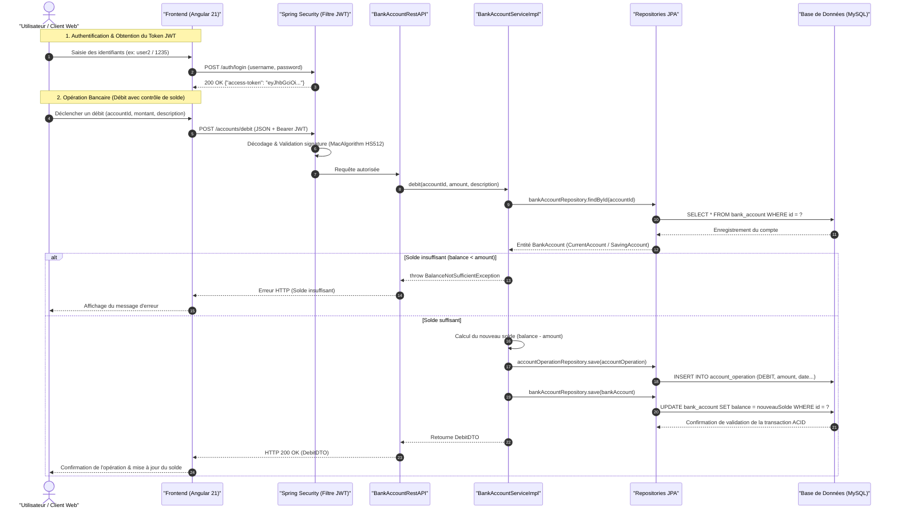

# Architecture du Système — Digital Banking

> Ce document décrit l'architecture technique, les choix de conception et les flux de données de **Digital Banking**.

---

## 1. Vue d'ensemble (High-Level Design)

L'application repose sur une architecture **Client-Serveur 3-Tiers découplée** et une conception en couches (Layered Architecture) garantissant la modularité, la sécurité transactionnelle et la scalabilité :

- **Couche Présentation (Frontend) :** Single Page Application développée avec **Angular 21**, communicant avec le backend via des requêtes HTTP asynchrones (services basés sur `HttpClient` et `RxJS`).
- **Couche Exposition & Sécurité (Backend API) :** API RESTful propulsée par **Spring Boot 4.0** et sécurisée par **Spring Security** avec un serveur de ressources OAuth2 (jetons JWT signés via HMAC-SHA512).
- **Couche Métier & Service :** Logique bancaire centralisée dans `BankAccountServiceImpl`, gérant les opérations transactionnelles ACID (`@Transactional`), les règles de gestion (contrôle de solde, découverts) et la transformation des données via `BankAccountMapperImpl`.
- **Couche Persistance & Stockage :** Modélisation relationnelle gérée par **Spring Data JPA** et **Hibernate ORM**, stockée dans **MySQL** (avec possibilité de bascule vers la base en mémoire **H2**).

  
  
<em>Figure 1 : Architecture globale du système</em>

---

## 2. Composants Principaux

| Composant | Technologie | Rôle & Responsabilités |
| :--- | :--- | :--- |
| **Client / Frontend** | `Angular 21`, `TypeScript`, `RxJS`, `Bootstrap 5` | Interface utilisateur réactive, routage client, formulaires réactifs (recherche, création de client), et consommation des endpoints REST. |
| **Sécurité & Contrôle d'accès** | `Spring Security`, `OAuth2 Resource Server`, `Nimbus JWT` | Authentification stateless, encodage et décodage des jetons JWT (HS512), et filtrage des autorisations basées sur les rôles (`SCOPE_USER`, `SCOPE_ADMIN`). |
| **Contrôleurs REST** | `Spring Web MVC` (`@RestController`) | Exposition des points d'accès HTTP (`CustomerRestController`, `BankAccountRestAPI`, `SecurityController`), validation des entrées et gestion CORS (`@CrossOrigin("*")`). |
| **Couche Métier & Mappage** | `Spring Service`, `BankAccountMapperImpl` | Traitement des flux bancaires (crédit, débit, virement, pagination), contrôle des règles métier et découplage Entités/DTOs. |
| **Persistance des Données** | `Spring Data JPA`, `Hibernate`, `MySQL 8` / `H2` | Gestion du schéma relationnel, héritage de tables (`SINGLE_TABLE` pour les comptes), requêtes JPQL/SQL et transactions atomiques. |

---

## 3. Flux de données (Data Workflow)

Le diagramme ci-dessous illustre le cycle de vie complet d'une requête dans le système : l'authentification de l'utilisateur suivie de l'exécution d'une opération bancaire transactionnelle (débit avec contrôle de solde) :

---

## 4. Modèle de données & Stockage

La base de données relationnelle modélise les entités bancaires avec une stratégie d'héritage optimisée pour les comptes :

- **Customer (Clients) :**
  - Entité représentant le titulaire du compte : `id` (clé primaire auto-incrémentée), `name` (nom du client), `email` (adresse courriel).
  - Relation `1:N` avec `BankAccount` (`@OneToMany(mappedBy = "customer", cascade = CascadeType.REMOVE)`). La suppression d'un client supprime en cascade l'ensemble de ses comptes bancaires.

- **BankAccount (Comptes Bancaires - Héritage Polymorphique) :**
  - Stratégie d'héritage : `@Inheritance(strategy = InheritanceType.SINGLE_TABLE)`. Une table unique regroupe tous les comptes pour des performances optimales sur les jointures et recherches polymorphiques.
  - Colonne discriminante : `TYPE` (taille 4, valeurs `"CA"` pour Compte Courant, `"SA"` pour Compte Épargne).
  - Propriétés partagées : `id` (identifiant unique String / UUID), `createdAt` (date de création), `balance` (solde actuel), `accStatus` (`CREATED`, `ACTIVATED`, `SUSPENDED`), `currency` (devise).
  - **CurrentAccount (Compte Courant) :** Sous-classe identifiée par `@DiscriminatorValue("CA")`, ajoutant l'attribut `overDraft` (découvert autorisé).
  - **SavingAccount (Compte Épargne) :** Sous-classe identifiée par `@DiscriminatorValue("SA")`, ajoutant l'attribut `interestRate` (taux d'intérêt).
  - Relation `1:N` avec `AccountOperation` (`@OneToMany(mappedBy = "bankAccount", cascade = CascadeType.REMOVE)`).

- **AccountOperation (Historique des Transactions) :**
  - Historise chaque transaction : `id` (identifiant unique auto-incrémenté), `operationDate` (date et heure de l'opération), `amount` (montant), `description` (motif ou libellé de l'opération).
  - Énumération `type` (`DEBIT`, `CREDIT`).
  - Relation `N:1` avec `BankAccount` (`@ManyToOne`).

---

## 5. Sécurité & Déploiement

- **Authentification Stateless JWT :**
  - Architecture stateless basée sur `Spring Security OAuth2 Resource Server`.
  - Signature symétrique chiffrée par clé secrète configurée dans `jwt.secret` via l'algorithme `MacAlgorithm.HS512` (Nimbus JOSE).
  - Durée de vie du jeton : 10 minutes après émission.
- **Contrôle d'Accès Basé sur les Rôles (RBAC) :**
  - Sécurisation déclarative des méthodes avec `@EnableMethodSecurity(prePostEnabled = true)`.
  - Comptes utilisateurs intégrés via `InMemoryUserDetailsManager` :
    - `user1` (mot de passe `1234`) : autorité `USER` (droit de lecture sur les comptes et clients).
    - `user2` (mot de passe `1235`) : autorités `USER` et `ADMIN` (droit d'écriture, création, mise à jour et suppression de clients).
- **Gestion des échanges Cross-Origin (CORS) :**
  - Contrôleurs annotés avec `@CrossOrigin("*")` pour permettre la communication fluide avec l'application Angular servie sur le port 4200.
- **Persistance :**
  - Base de données MySQL configurée avec `createDatabaseIfNotExist=true` et mise à jour automatique du schéma via Hibernate (`ddl-auto=update`).
  - Console H2 accessible en environnement de développement pour l'inspection rapide des données.

---
[⬅ Retour au README principal](../README.md)
